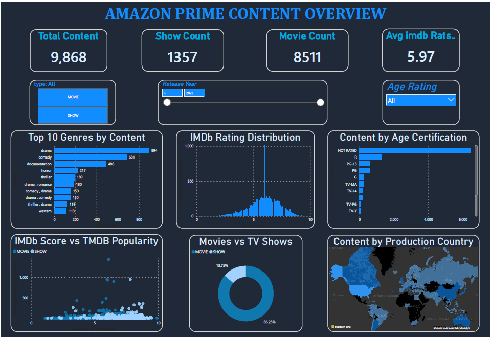
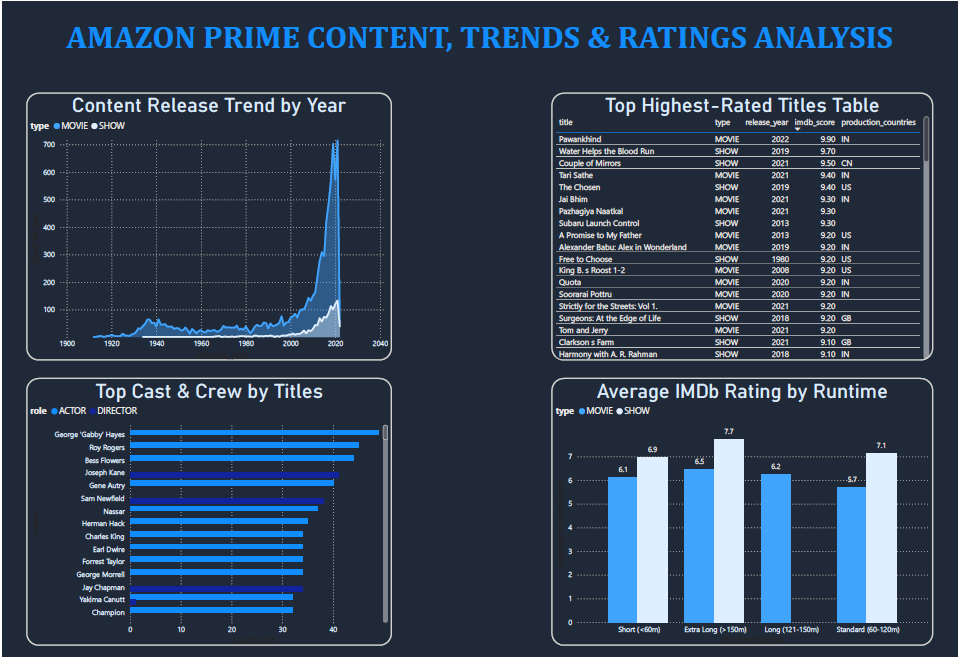

# 🎬 Amazon Prime Video Content Analysis (EDA & Power BI)

## 📌 Project Overview
An end-to-end Exploratory Data Analysis (EDA) and interactive dashboard project analyzing Amazon Prime Video's content library. The project explores content distribution, genre trends, release patterns, IMDb/TMDB ratings, and cast/crew insights across **9,868 unique titles** (125,186 merged records).

## 🛠️ Tools & Technologies
* **Python:** Pandas, NumPy, Matplotlib, Seaborn (Data Cleaning, Merging & EDA)
* **Power BI:** Data Modeling, DAX, Interactive Visuals & Slicers
* **Google Colab / Jupyter Notebook:** Analysis & Documentation

## 📂 Repository Structure
* [`Data/`](./Data/README.md) — Dataset documentation, schema (19 columns), and Google Drive download link
* [`Python/Amazon_EDA.ipynb`](./Python/Amazon_EDA.ipynb) — Complete data cleaning, preprocessing, and exploratory data analysis notebook
* [`PowerBI/Amazon_Prime_Dashboard.pbix`](./PowerBI/Amazon_Prime_Dashboard.pbix) — Interactive Power BI dashboard file
* [`PowerBI/Amazon_Prime_Dashboard.pdf`](./PowerBI/Amazon_Prime_Dashboard.pdf) — Static PDF export of the dashboard for quick viewing
* [`Dashboard_Screenshots/`](./Dashboard_Screenshots/) — High-resolution dashboard visuals

## 📊 Dashboard Previews

### 1. Executive Dashboard

### 2. Detailed Analysis

## 🔍 Key Insights
* **Content Mix:** Movies make up the majority of Amazon Prime Video's catalog compared to TV Shows.
* **Release Trends:** Significant growth in content additions over the last decade, reflecting aggressive library expansion.
* **Top Genres:** Drama, Comedy, and Action dominate both volume and audience engagement.
* **Ratings & Popularity:** Analyzed IMDb and TMDB score distributions to identify top-performing genres and content categories.

## 🚀 How to Use This Project
1. View the complete Python analysis directly in [`Python/Amazon_EDA.ipynb`](./Python/Amazon_EDA.ipynb).
2. Download the cleaned dataset from the link in [`Data/README.md`](./Data/README.md).
3. Open [`PowerBI/Amazon_Prime_Dashboard.pbix`](./PowerBI/Amazon_Prime_Dashboard.pbix) in Power BI Desktop, or view [`PowerBI/Amazon_Prime_Dashboard.pdf`](./PowerBI/Amazon_Prime_Dashboard.pdf) directly on GitHub.

---

## 👤 Author
**Ankit Gurjar**  

